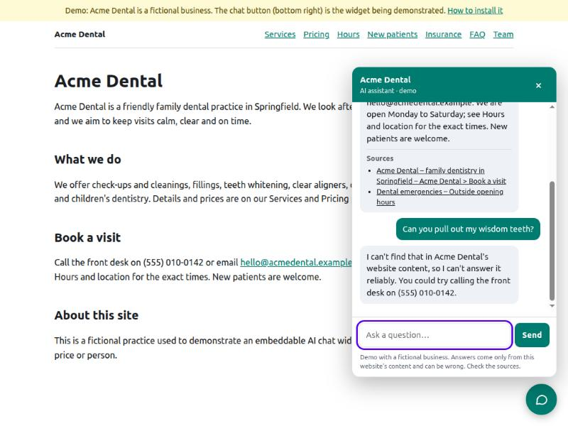
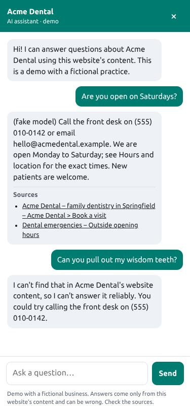

# Embeddable AI chat widget (demo)

A small portfolio demo by Rajkamal Das. A business pastes one `<script>` tag on its site; visitors can ask
questions and get answers taken **only from that business's own pages**, with source links, and an honest
"I can't find that" when the content doesn't cover the question.

> **This is a demo, not a client product.** The sample business ("Acme Dental") is fictional. It runs on a free-tier
> model, uses keyword search (no embeddings), and can still be wrong. See [Known limitations](#known-limitations).

```html
<script src="https://YOUR-HOST/widget.js" data-site="acme-dental" async></script>
```

Screenshots (UI only; these were taken with a **local stub model**, not real Gemini output, so the answer text that
starts with "(fake model)" is placeholder text):

| Desktop | Mobile |
|---|---|
|  |  |

## What it does

- **Widget**: vanilla TypeScript in a Shadow DOM, ~9.6 kB (4 kB gzipped), no framework on the host page. Floating
  button and panel, full-screen on phones, Escape closes, Tab stays inside the open panel, focus returns to the button,
  `aria-live` message log, labelled input, reduced-motion and dark-mode aware. Model output is inserted with
  `textContent`, never as HTML.
- **API** (Next.js route handlers): per-site config, origin allow-list + CORS, BM25 retrieval, Gemini call with a JSON
  response schema validated by zod, citation gating, refusals, per-visitor rate limit and daily cap, off switch.
- **Ingestion CLI**: takes a sitemap URL, a list of URLs, or a folder of markdown files, respects `robots.txt`, strips
  page boilerplate, chunks by heading, and writes a JSON index. No database.
- **Demo + docs**: a fake dental site at `/demo` (rendered from the same markdown the index is built from, so every
  source link lands on a real page and heading) and install docs at `/embed`.

## Architecture

```
 Customer website                         Your host (Vercel / any Node host)
┌──────────────────────┐   1. GET widget.js          ┌──────────────────────────────────────────┐
│ <script data-site=…> │ ───────────────────────────▶│ public/widget.js   (Vite IIFE bundle)    │
│                      │                             │                                          │
│  Shadow DOM widget   │   2. GET /api/config?site=  │ /api/config   origin allow-list ─▶ public│
│  (button + panel)    │ ───────────────────────────▶│               fields only (name, colour…)│
│                      │                             │                                          │
│                      │   3. POST /api/chat?site=   │ /api/chat                                │
│                      │ ───────────────────────────▶│   a. site lookup + origin allow-list     │
│                      │                             │   b. off switch, zod request validation  │
│                      │                             │   c. rate limit (per visitor + daily)    │
│                      │                             │   d. BM25 over the site's chunks         │
│                      │                             │        └─ no keyword overlap ─▶ refuse   │
│                      │                             │           (no model call)                │
│                      │                             │   e. Gemini (JSON schema) ─ zod validate │
│                      │                             │   f. citation gate: keep only retrieved  │
│                      │                             │      ids; none valid ─▶ "not covered"    │
│                      │◀─────────────────────────── │   g. build source links server-side     │
└──────────────────────┘   answer + sources          └───────────────▲──────────────────────────┘
                                                                     │ loaded at startup
  Owner, once per site / when the website changes                    │
  npm run ingest -- --site X --sitemap|--urls|--dir ──▶ data/sites/X/index.json (+ site.json, hand-written)
                                                        └─▶ src/generated/sites.ts (registry, auto-generated)
```

Key design decisions (kept from my earlier portfolio assistant):

- **Keyword retrieval (BM25) over in-memory chunks.** No vector database, no embedding calls, free, deterministic, easy
  to test. The cost is that paraphrases with no shared words are missed.
- **Citation-gated answers.** The model must return the ids of the passages it used. Ids that were not retrieved are
  dropped; if none are left, the visitor gets the "not covered" answer instead of the model's text.
- **Structured output.** Gemini's `responseSchema` asks for `{answer, sourceIds, canAnswer}`; zod validates it again on
  our side.
- **Visitor text and page text are data.** The system prompt says so, visitor text is only ever sent as a user turn,
  and assistant turns sent by the browser are never forwarded to the model.
- **Refuse before the model when nothing matches.** Zero keyword overlap means no model call and no quota spent.
- **Broad questions** ("what do you offer?") pull in the overview chunk of several pages (`diversify`,
  `withOverviews`, `isBroadQuestion`), so the answer is not built from one page.
- **Source links are built on the server** from the stored page URLs, never from model output.

## Run it

Requires Node 20+.

```bash
npm install
cp .env.example .env.local        # then put your own free Gemini key in GEMINI_API_KEY
npm run dev                       # builds the widget, then starts Next.js (webpack) on :3000
```

Open <http://localhost:3000/demo> and use the chat button. The demo site's `allowedOrigins` includes
`http://localhost:3000`, and it also accepts calls from its own host (`allowSameOrigin`).

Useful commands:

```bash
npm test                 # unit + handler tests (vitest)
npm run typecheck
npm run eval             # retrieval eval, no model call
npm run build            # builds public/widget.js, then `next build --webpack`
npm start                # serve the production build
npx tsx scripts/fake-gemini.ts   # a FAKE Gemini endpoint for local testing without a key (see below)
```

**Testing without a key.** Start the stub and point the API at it:

```bash
npx tsx scripts/fake-gemini.ts &
GEMINI_API_BASE=http://127.0.0.1:4010 GEMINI_API_KEY=fake npm start
```

The stub cites the first source it is given and quotes it. It proves the plumbing (schema, citation gate, UI), **not
answer quality**.

## Environment variables

| Variable | Default | Meaning |
|---|---|---|
| `GEMINI_API_KEY` | (none) | Your own free key from Google AI Studio. Server-side only; never in the page or the script tag. |
| `GEMINI_MODEL` | `gemini-3.5-flash-lite` | Model name. `gemini-2.5-flash` returned 404 for new API keys, so it is not the default. No `thinkingConfig` is sent. |
| `GEMINI_API_BASE` | Google's endpoint | Only for tests against a local stub. Leave unset in production. |
| `CHAT_ENABLED` | `true` | Set to `false` to switch the chat off: `/api/chat` returns 503 without calling the model and the widget stays hidden. |
| `CHAT_MAX_PER_10_MIN` | `8` | Messages per visitor (per site + IP) per 10 minutes. |
| `CHAT_MAX_PER_DAY` | `300` | Global daily cap per server instance. |

When Gemini returns an error, the API logs Google's HTTP status and error message (never the key or the request body)
so failures such as "model not found" are diagnosable from the server log.

## Add a new business

1. Create `data/sites/<id>/site.json` (copy `data/sites/acme-dental/site.json`; every field is documented on `/embed`).
   The important one is `allowedOrigins`: the customer's real site, for example
   `["https://www.example.com", "https://*.example.com"]`.
2. Build the index from pages the owner points you at:
   ```bash
   npm run ingest -- --site <id> --sitemap https://www.example.com/sitemap.xml
   npm run ingest -- --site <id> --urls urls.txt          # file with one URL per line, or a,b,c
   npm run ingest -- --site <id> --dir ./their-content    # markdown files; optional frontmatter: title, url
   ```
   This writes `data/sites/<id>/index.json` and regenerates `src/generated/sites.ts`. Options: `--max-pages 50`,
   `--delay-ms 500`.
3. Redeploy, then give the customer the one-line script tag with `data-site="<id>"`.

The ingestion script fetches only the pages you give it (or the sitemap's own host), identifies itself with a user agent,
checks `robots.txt` for every host, waits between requests, caps page count and size, and reports what it skipped and why.
It reads HTML text only: pages that render their content with JavaScript, PDFs and images are skipped. Re-run it when the
customer's site changes.

## Evaluation (read the caveats)

`npm run eval` runs 25 questions (17 answerable, 8 not answerable) over the sample content and does **not** call a model.

**Who wrote the questions:** I (an AI assistant working with the developer) wrote them at the same time as the sample
content, using words close to it. That favours this corpus. These numbers say little about real customer sites, and the
set is too small for fine distinctions.

Result of the last run (retrieval only, page level):

| Measure | Result |
|---|---|
| Top-1 hit rate (answerable) | 15/17 (88%) |
| Top-3 hit rate (answerable) | 16/17 (94%) |
| Off-topic / uncovered / injection questions refused **before** any model call | 3/8 (38%) |
| Those same questions that **do** reach the model | 5/8 (63%) |

The last row matters: most unanswerable questions share at least one ordinary word with the content (for example
"weather in Springfield", "previous instructions", "teeth"), so they reach the model and rely on the prompt rules and the
citation gate to be refused. **That behaviour has not been measured against a real model** (see below). Missed top-1 cases
are printed by the script, for example "Can I pay for treatment in instalments?" ranks the insurance page first.

`npm run eval -- --live` runs the full pipeline against the real model and checks only the refusal decision and the cited
pages (not answer wording). It needs your `GEMINI_API_KEY`, uses free-tier quota and waits ~4.5 s between calls.

## Cost and free-tier limits

- **Hosting:** Vercel's free (Hobby) plan is enough for a demo. It has usage limits and is meant for non-commercial use;
  check Vercel's current terms before using it for a paying client.
- **Model:** a free Gemini API key from Google AI Studio. Free-tier quotas (requests per minute and per day) change, and
  free-tier data may be used by Google to improve its products under its terms, so check the current Gemini API pricing
  and terms pages before sending anything private. When the quota runs out the widget shows a friendly message (HTTP 429
  from the API). I did not verify current quota numbers.
- **Everything else is free:** no database, no vector store, no paid service. The index is a JSON file in the repo.
- **Why the limits exist:** `CHAT_MAX_PER_10_MIN` and `CHAT_MAX_PER_DAY` stop one visitor or a bot from using up the free
  quota. Retrieval that finds nothing never calls the model.

## Security notes

- **The origin allow-list is not authentication.** It stops other websites from embedding your chat in a browser. Anyone
  can send a request with a forged `Origin` header from a script, so the endpoint is effectively public. Requests with no
  `Origin` are rejected, but that is a convenience and not a defence. The real protections are the rate limits, the small
  max message size, and having nothing sensitive behind the API.
- **Rate limits are per server instance.** They live in memory. Serverless platforms run several instances and restart
  them, so the effective limit is looser than configured, and the daily cap resets on cold start.
- **Don't embed secrets.** The script tag contains only a public site id. The Gemini key lives in server environment
  variables and is never sent to the browser or logged.
- **Prompt injection.** Visitor text and page text are treated as data and the model may only cite retrieved passages, but
  no prompt is a guarantee. A hostile page in the index could still try to steer answers, which is why the owner chooses
  the pages. The assistant has no tools and no access to anything except the index.
- **Output is rendered as text**, so a model reply cannot inject HTML or script into the host page.
- **Host-page CSS:** the widget is isolated by Shadow DOM and survived an aggressive test stylesheet. A hostile host page
  could still hide or remove it, which is the host's choice.
- **Privacy:** visitor messages are sent to Google's Gemini API. Nothing is stored by this app (the conversation is kept
  in the visitor's `sessionStorage`), but the host should say so in its privacy policy.

## What was verified and what was not

Verified in this repo:

- 53 unit and handler tests pass (`npm test`): retrieval, chunking, robots.txt, HTML extraction, citation gating, refusal
  without a model call, prompt-injection handling in the request path, rate limiter, CORS allow-list, zod schemas, the
  off switch, and error mapping.
- `npm run build` (webpack production build) succeeds; the typecheck is clean.
- Over real HTTP against `next start` with the **fake Gemini stub**: allowed and blocked origins, CORS preflight, answer
  with server-built links, refusal with and without overlap, and the demo pages (with heading anchors).
- In a browser: the widget mounts from a different origin when allowed and does not load when not allowed, opens, sends a
  suggested question and a typed one, shows sources and a refusal, closes with Escape and returns focus to the button,
  fills the screen at 375 px width with no horizontal scroll, and ignores an aggressive host stylesheet.

**Not verified:**

- **No real Gemini call was made** (no key was available). The request format follows the reference implementation, but
  the live model's answer quality, its refusals on the questions that reach it, its JSON-schema behaviour and the default
  model name `gemini-3.5-flash-lite` are untested here. Run `npm run eval -- --live` with your own key.
- **Not deployed to Vercel.** Only a local production build was run. The data files are imported statically, so no
  special file-tracing config should be needed, but that is untested on Vercel.
- **Screen readers, iOS Safari and other browsers** were not tested; accessibility was checked by keyboard and by
  reading the DOM, not with assistive technology.
- The ingestion CLI was run on the markdown folder only. The sitemap and URL modes (fetch, robots.txt, extraction) are
  covered by unit tests of their parts but were **not run against a live website**.

## Known limitations

- **Keyword search only.** "Do you fix crooked teeth?" will not find "clear aligners" unless words overlap. A tiny
  built-in rule maps "how much / cost / fee" to "price" and nothing else is expanded.
- **Snapshot content.** The index is as old as the last ingest. There is no scheduled re-crawl.
- **Text pages only.** JavaScript-rendered pages, PDFs, images and anything behind a login are not read.
- **English-focused.** Stopwords and the price rule are English. Other languages are untested.
- **No sign-up, no admin UI, no per-tenant auth.** Sites are added by hand-editing JSON and running the CLI.
- **No analytics, no lead capture, no human handoff.**
- **Answers can still be wrong or incomplete** even with citations; the sources are shown so a visitor can check.
- Conversation memory is only the last few visitor questions.

## What I would do for a paid client

- **Embeddings (hybrid search).** Add vector search (for example Postgres + pgvector) next to BM25 so paraphrases are
  found, with a similarity threshold so the "refuse when nothing matches" behaviour is kept.
- **Shared rate-limit store** (Redis/Upstash or a DB table) so limits hold across serverless instances, plus per-site
  quotas and bot protection (Turnstile) on the chat endpoint.
- **Self-serve tenants:** sign-up, a dashboard to add pages and see index status, scheduled re-indexing, signed or
  per-site keys where it makes sense, and a Postgres store for sites and chunks.
- **Analytics:** which questions are asked, which are refused (the content gaps), thumbs up/down, cost per site.
- **Lead capture and human handoff:** when the bot can't answer, offer to take a name and email or hand the chat to a
  person; push leads to the client's CRM or email.
- **A bigger, client-written evaluation set** with answer grading, run in CI against recorded model responses and on
  demand against the live model.
- **Privacy and compliance review:** data retention, a paid model tier with the right data terms, consent text.

## Project layout

```
widget/src/            the embeddable widget (vanilla TS) -> built to public/widget.js by Vite
src/lib/               retrieval, chunker, robots, HTML extraction, Gemini client, rate limiter, CORS, request handler
src/app/api/           /api/chat and /api/config (thin wrappers over the handler)
src/app/demo, /embed   the fake business site and the install docs
src/generated/sites.ts auto-generated registry of sites (written by the ingest CLI)
data/sites/<id>/       site.json (hand-written), index.json (generated), content/ (sample markdown)
data/eval/             evaluation questions
scripts/               ingest, eval, register, fake-gemini
tests/                 vitest tests
```
